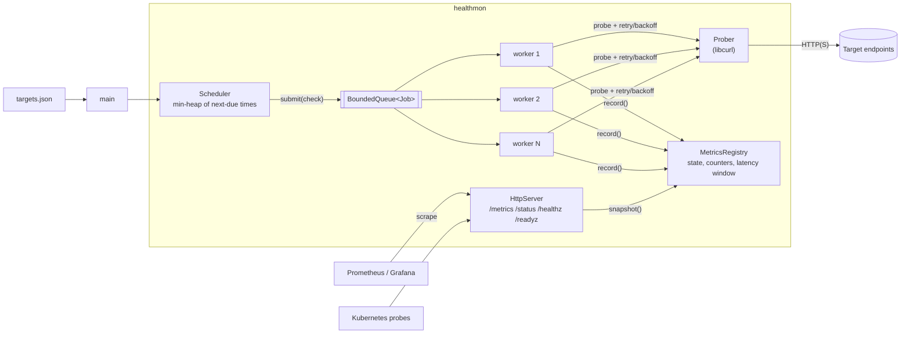

# cloud-health-monitor

[](https://github.com/roberto-t-plascencia/cloud-health-monitor/actions/workflows/ci.yml)


A multithreaded C++20 service that checks HTTP(S) endpoints on a schedule. It retries failures with exponential backoff and jitter, tracks latency percentiles and uptime, and classifies each target as **UP**, **DEGRADED**, or **DOWN**. Metrics are published in Prometheus format, so it plugs straight into Grafana, Prometheus, or Azure Monitor managed Prometheus. It runs as a small, non-root container on Kubernetes.

Example run (your latencies will differ):

```text
$ healthmon --config config/targets.json --once

TARGET               STATE     STATUS   LATENCY  DETAIL
cloudflare-trace     UP           200      21ms  https://1.1.1.1/cdn-cgi/trace
demo-failing         DEGRADED     503     148ms  unexpected status 503 (expected 200)
github-api           UP           200      94ms  https://api.github.com/zen
google-204           UP           204      38ms  https://www.google.com/generate_204
```

## Features

- **Concurrent checks** on a fixed-size thread pool, fed by a bounded queue for backpressure.
- **Drift-free scheduling.** A min-heap of next-due times lets the scheduler sleep until exactly the next check is due. Start times are staggered across each interval to avoid load spikes.
- **No overlapping probes.** If a slow target is still being checked when its next tick comes, that tick is skipped and logged instead of piling up.
- **Retries with exponential backoff and full jitter**, so many monitors don't hit a struggling service in lockstep.
- **Health states.** DOWN after N consecutive failures. DEGRADED while a target is failing but not yet DOWN, or when p95 latency exceeds its threshold.
- **Sliding-window latency percentiles** (p50/p95/p99) over successful checks.
- **Endpoints:** `/metrics` (Prometheus), `/status` (JSON), `/healthz` (liveness), and `/readyz` (ready once every target has been checked).
- **Structured JSON logs** for state changes and failures, readable by Fluent Bit, Azure Monitor, or CloudWatch without custom parsing.
- **Graceful shutdown.** On SIGTERM, retry backoff sleeps are interrupted and in-flight checks are drained, so pods stop in well under a second.
- **Production packaging:** a multi-stage Docker image that runs as a non-root user with a read-only root filesystem, plus Kubernetes manifests with probes, resource limits, and Prometheus scrape annotations.

## Architecture



| Component | File | Responsibility |
|---|---|---|
| `Scheduler` | `src/scheduler.cpp` | Decides when each target runs, stops overlapping checks, coordinates shutdown |
| `ThreadPool` / `BoundedQueue` | `include/healthmon/thread_pool.hpp` | Fixed workers with `std::jthread`, blocking bounded queue with close semantics |
| `runWithRetry` | `src/retry.cpp` | Exponential backoff with full jitter; sleep and stop check are injected for testability |
| `CurlProber` | `src/curl_prober.cpp` | Thread-safe HTTP(S) probe: per-request timeouts, redirects, no signals |
| `MetricsRegistry` | `src/metrics.cpp` | Thread-safe per-target counters, state machine, ring-buffer latency window |
| `HttpServer` | `src/http_server.cpp` | Minimal POSIX-socket HTTP/1.1 server; polls so it can stop promptly |
| Exporters | `src/prometheus.cpp` | Prometheus text format and JSON status |

### Design notes

- **Interfaces for testability.** The scheduler depends on an abstract `Prober`, so tests use a fake that can be slow, fail on demand, and report its peak concurrency. Retry logic takes injected sleep and stop functions, so backoff tests run instantly.
- **Locking.** A single mutex per component keeps the code easy to reason about. `record()` is O(1), and percentiles are computed only when a snapshot is taken, so lock hold times stay short. The scheduler never holds its own lock while calling into the thread pool.
- **A race that ThreadSanitizer caught.** The first version of the worker's completion step notified the condition variable *after* unlocking. `stop()` could then see `pending_ == 0`, return, and destroy the `Scheduler` while a worker was still inside `notify_all()`. The fix is to notify while holding the lock. CI runs the full test suite under TSan and ASan/UBSan on every push to catch regressions like this.
- **Signals.** SIGINT and SIGTERM are blocked in every thread, and `main()` waits for them with `sigwait()`. No work happens inside an async signal handler.

## Quick start

Requirements: Linux, macOS, or WSL on Windows, plus CMake 3.20+, a C++20 compiler (GCC 11+ or Clang 14+), and libcurl. GoogleTest and nlohmann/json are fetched automatically.

```bash
# Ubuntu / Debian / WSL
sudo apt-get install -y build-essential cmake git libcurl4-openssl-dev

cmake -S . -B build -DCMAKE_BUILD_TYPE=Release
cmake --build build -j
ctest --test-dir build --output-on-failure

./build/healthmon --config config/targets.json --once   # one pass, then exit
./build/healthmon --config config/targets.json          # run as a service
curl localhost:9100/metrics
curl localhost:9100/status
```

### Docker

```bash
docker build -t cloud-health-monitor .
docker run --rm -p 9100:9100 cloud-health-monitor
# or mount your own config
docker run --rm -p 9100:9100 -v "$PWD/config:/etc/healthmon:ro" cloud-health-monitor
```

CI publishes the image to `ghcr.io/roberto-t-plascencia/cloud-health-monitor` on every push to `main`.

### Kubernetes

```bash
kubectl apply -k deploy/k8s
kubectl port-forward svc/healthmon 9100:9100
```

The Deployment runs as a non-root user with a read-only root filesystem and all capabilities dropped. It uses `/healthz` for liveness and `/readyz` for readiness, and carries `prometheus.io/*` scrape annotations. Targets come from the ConfigMap.

## Configuration

```json
{
  "metrics_port": 9100,
  "workers": 4,
  "failure_threshold": 3,
  "targets": [
    {
      "name": "orders-api",
      "url": "https://orders.example.com/health",
      "interval_ms": 15000,
      "timeout_ms": 3000,
      "expected_status": 200,
      "degraded_latency_ms": 1000,
      "retry": { "max_attempts": 3, "base_delay_ms": 200, "max_delay_ms": 2000 }
    }
  ]
}
```

| Field | Default | Notes |
|---|---|---|
| `metrics_port` | 9100 | Can be overridden with `--port` |
| `workers` | 4 | Thread pool size (1–256) |
| `failure_threshold` | 3 | Consecutive failed checks before a target is DOWN |
| `targets[].interval_ms` | 15000 | Time between checks |
| `targets[].timeout_ms` | 3000 | Per-attempt timeout; must not exceed the interval |
| `targets[].expected_status` | 200 | Any other status counts as a failure |
| `targets[].degraded_latency_ms` | 1000 | p95 above this marks the target DEGRADED |
| `targets[].retry.*` | 3 / 200 / 2000 | Attempts per check, first backoff delay, backoff cap |

Validation errors name the exact field, for example `targets[2].timeout_ms must not exceed interval_ms`. The config path can also be set with the `HEALTHMON_CONFIG` environment variable.

## Metrics

| Metric | Type | Description |
|---|---|---|
| `healthmon_target_up` | gauge | 1 if the last check succeeded |
| `healthmon_target_state{state=...}` | gauge | One series per state; the active state is 1 |
| `healthmon_checks_total` | counter | Checks performed |
| `healthmon_check_failures_total` | counter | Checks that still failed after retries |
| `healthmon_retries_total` | counter | Retry attempts beyond the first try |
| `healthmon_latency_seconds{quantile=...}` | gauge | p50 / p95 / p99 over the recent window |
| `healthmon_uptime_ratio` | gauge | Successful checks / total checks |

Example alert rule: `healthmon_target_state{state="DOWN"} == 1 for 2m`.

## Testing

- **45 unit tests** (GoogleTest) cover config validation, backoff bounds and jitter, the retry loop, the health state machine, percentile math, Prometheus output, the HTTP server (over real sockets), the thread pool, and scheduler behavior (interval timing, no overlapping probes, parallelism, failure → DOWN → recovery, fast shutdown during backoff).
- **End-to-end smoke test:** `scripts/smoke_test.sh` starts a local server with healthy, slow, and failing endpoints, runs the real binary, checks `/metrics`, `/status`, and `/readyz`, and verifies a clean SIGTERM shutdown.
- **CI** (GitHub Actions) runs GCC and Clang builds, the smoke test, ASan+UBSan and TSan runs (each repeated 3 times), and the Docker image build.

## Project layout

```text
include/healthmon/   public headers
src/                 implementation + main.cpp
tests/               GoogleTest unit tests
scripts/             end-to-end smoke test
config/              example configuration
deploy/k8s/          Kubernetes manifests (kustomize)
.github/workflows/   CI pipeline
```

## Roadmap

- Per-target custom headers and auth (bearer token from a mounted secret)
- TCP and DNS check types alongside HTTP
- Hot reload of the config on SIGHUP
- OpenTelemetry metrics export
- Alert webhooks (Slack / Teams) on state changes

## License

MIT. See [LICENSE](LICENSE).
